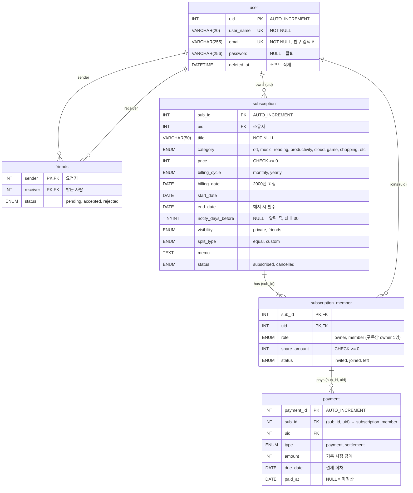

# MyTracker ERD

`server/myTracker_sample.sql`로 만든 DB(`mytracker_sample`) 기준 ERD입니다. MySQL 8.0에서 샘플 파일을 실행하고, 테이블 구조와 키를 그대로 옮겼습니다.

## 관계

| 관계 | 카디널리티 | 키 |
|---|---|---|
| user → friends | 1 : N (요청자, 받는 사람 각각) | `friends.sender`, `friends.receiver` → `user.uid` |
| user → subscription | 1 : N (소유자) | `subscription.uid` → `user.uid` |
| subscription → subscription_member | 1 : N (owner 행 1개 이상 필수) | `subscription_member.sub_id` → `subscription.sub_id` |
| user → subscription_member | 1 : N (참여한 구독) | `subscription_member.uid` → `user.uid` |
| subscription_member → payment | 1 : N (결제·정산 기록) | `payment(sub_id, uid)` → `subscription_member(sub_id, uid)` |

`subscription_member`는 user와 subscription의 N : M 관계(공유 구독)를 푸는 연결 테이블입니다.

## 키와 제약 조건

| 테이블 | 제약 | 의미 |
|---|---|---|
| user | `UNIQUE(user_name)`, `UNIQUE(email)` | 이름·이메일 중복 금지 |
| user | `CHECK (deleted_at IS NOT NULL OR password IS NOT NULL)` | 활성 회원은 비밀번호 필수 |
| friends | `UNIQUE(LEAST(sender, receiver), GREATEST(sender, receiver))` | A→B, B→A 중복 요청 금지 |
| friends | `CHECK (sender <> receiver)` | 자기 자신에게 요청 금지 |
| subscription | `CHECK (status <> 'cancelled' OR end_date IS NOT NULL)` | 해지 시 종료일 필수 |
| subscription | `CHECK (YEAR(billing_date) = 2000)`, 월간은 `MONTH = 1` | 결제일 인코딩 규칙 |
| subscription | `CHECK (notify_days_before <= 30)` | 알림은 최대 30일 전 |
| subscription_member | `UNIQUE(IF(role = 'owner', sub_id, NULL))` | 구독당 owner 1명 |
| payment | `UNIQUE(sub_id, uid, type, due_date)` | 같은 회차 중복 기록 금지 |
| payment | `CHECK (type = 'settlement' OR paid_at IS NOT NULL)` | 실제 결제는 낸 날 필수 |

## 정규화 (3NF)

모든 테이블은 기본키가 아닌 컬럼이 기본키 전체에만 함수적으로 종속되고, 기본키가 아닌 컬럼끼리의 종속(이행 종속)이 없습니다.

- **1NF**: 모든 컬럼이 원자값입니다. 공유 참여자는 콤마 목록이 아니라 `subscription_member` 행으로, 결제 이력은 `payment` 행으로 분리했습니다.
- **2NF**: 복합키 테이블(`friends`, `subscription_member`)의 일반 컬럼(`status`, `role`, `share_amount`)은 키의 일부가 아니라 키 전체(누가 어느 구독에서)에 종속됩니다. 사용자 이름이나 구독료처럼 키 일부에만 종속되는 값은 `user`, `subscription`에만 둡니다.
- **3NF**: 저장하지 않고 조회 때 계산하는 값
  - 다음 결제 예정일, 캘린더 일정 → `billing_cycle` + `billing_date`로 계산
  - 월 환산 금액, 월별·카테고리별 지출 통계 → `price`, `payment` 집계
  - 공유 인원 수, 정산 여부 → `subscription_member` 행 수, `paid_at IS NULL` 여부
  - 공유 구독 여부 → member 행 존재 여부 (별도 `is_shared` 컬럼 없음)
- `payment.amount`는 `price`의 복사본이 아니라 **기록 시점의 금액**입니다. 구독료가 바뀌어도 과거 결제 금액은 바뀌면 안 되므로 독립된 사실입니다 (샘플: Microsoft 365 2025년 109,000원 → 2026년 119,000원).
- `subscription_member.share_amount`도 custom 분담에서는 사용자가 정한 독립 값이고, 해당 행(누가 어느 구독에서)에만 종속됩니다.

## 샘플 데이터 요약

| 테이블 | 행 수 | 들어 있는 경우 |
|---|---|---|
| user | 6 | 활성 5명, 탈퇴 1명 (password NULL) |
| friends | 6 | accepted 3, pending 2, rejected 1 |
| subscription | 10 | 8개 카테고리 전부, 월간·연간, 해지 1건, 알림 on/off, 공개 범위, equal·custom |
| subscription_member | 15 | owner 10, joined 3, invited 1, left 1 |
| payment | 32 | payment 25, settlement 7 (미정산 1건 포함) |
